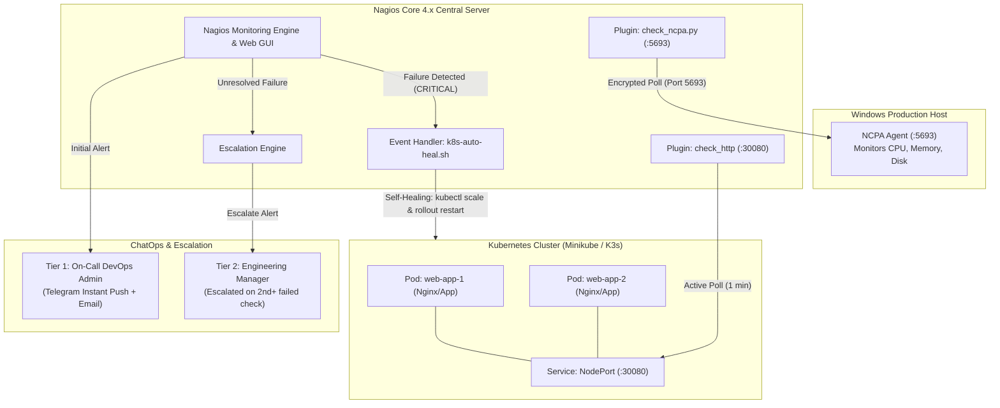

# Enterprise DevOps Project: Kubernetes Infrastructure Observability, Multi-OS Monitoring (Linux & Windows), Multi-Tier Alerting & Auto-Recovery System

**Project Type:** DevOps Capstone / Exam Viva Project  
**Target Architecture:** Kubernetes Container Orchestration + Nagios Core 4.x + NCPA Agent + Telegram/SMTP ChatOps  
**Team Size:** 4 Members  
**Duration:** 2 Days (Home Build & Prep $\rightarrow$ Live Demo & Presentation)  

---

## Table of Contents
1. [Executive Summary & Problem Statement](#1-executive-summary--problem-statement)
2. [High-Level Architecture & Data Flow](#2-high-level-architecture--data-flow)
3. [Team Division, GitOps Structure & Collaboration](#3-team-division-gitops-structure--collaboration)
4. [Phase-by-Phase Technical Implementation](#4-phase-by-phase-technical-implementation)
   - [Phase 1 (Member 1): Kubernetes Cluster & Containerized App](#phase-1-member-1-kubernetes-cluster--containerized-app)
   - [Phase 2 (Member 2): Nagios Server & Multi-OS Monitoring](#phase-2-member-2-nagios-server--multi-os-monitoring)
   - [Phase 3 (Member 3): Alerting, Escalations & Telegram ChatOps](#phase-3-member-3-alerting-escalations--telegram-chatops)
   - [Phase 4 (Member 4): Auto-Recovery Event Handler & Chaos Testing](#phase-4-member-4-auto-recovery-event-handler--chaos-testing)
5. [End-to-End Live Viva Demonstration Playbook](#5-end-to-end-live-viva-demonstration-playbook)
6. [Examiner Viva Defense & Question Bank (With Model Answers)](#6-examiner-viva-defense--question-bank-with-model-answers)

---

## 1. Executive Summary & Problem Statement

### The Problem
Modern cloud infrastructure relies heavily on container orchestration engines like Kubernetes to run microservices. However, internal cluster orchestration alone leaves critical operational blind spots:
1. **Lack of External End-to-End Synthetic Monitoring:** If a deployment is misconfigured, scaled to 0 replicas, or ingress/NodePort routes drop, internal pod restart loops cannot restore service accessibility for end users.
2. **Heterogeneous Infrastructure:** Real production setups run a mix of Linux worker nodes, Windows administration servers, and network devices. Teams struggle with fragmented monitoring tools.
3. **Alert Fatigue & Delayed Remediation:** Static alert emails often get buried. Without automated self-healing and tiered escalation policies, minor transient service crashes degrade into prolonged downtime.

### The Solution
We engineer an enterprise-grade, centralized monitoring and self-healing framework using **Nagios Core 4.x** integrated with **Kubernetes**:
* **Containerized Workload:** A multi-replica containerized web service deployed via Kubernetes Deployments and exposed via NodePort.
* **Dual-OS Centralized Observability:** Nagios continuously tests both Linux Kubernetes endpoints (HTTP/NodePort) and a Windows system (via Nagios Cross-Platform Agent - NCPA).
* **Multi-Tier Notification Engine:** High-priority instant push alerts via Telegram Bot and Postfix/SMTP Email, featuring an automated escalation policy (DevOps Engineer $\rightarrow$ Engineering Manager if unresolved).
* **Automated Remediation Loop:** An out-of-band **Nagios Event Handler** detects outage states (SOFT/HARD) and auto-remediates the broken Kubernetes deployment via automated `kubectl` reconciliation scripts without requiring human intervention.

---

## 2. High-Level Architecture & Data Flow



---

## 3. Team Division, GitOps Structure & Collaboration

To guarantee all 4 team members have verifiable hands-on contributions, the project is organized into a single Git repository (`devops-k8s-nagios-monitoring`) with modular ownership.

### Repository Layout
```
devops-k8s-nagios-monitoring/
├── README.md
├── k8s-manifests/                     # Owned by Member 1
│   ├── deployment.yaml
│   ├── service.yaml
│   └── cluster-setup.sh
├── nagios-core/                       # Owned by Member 2
│   ├── nagios.cfg
│   ├── objects/
│   │   ├── k8s-services.cfg
│   │   └── windows-node.cfg
│   └── ncpa-windows-config.md
├── alerting-escalation/               # Owned by Member 3
│   ├── contacts.cfg
│   ├── escalations.cfg
│   ├── telegram-alert.sh
│   └── postfix-relay-notes.md
└── auto-recovery-chaos/               # Owned by Member 4
    ├── k8s-auto-heal.sh
    ├── commands.cfg
    └── chaos-kill.sh
```

### Team Role Matrix

| Member | Engineering Title | Technical Responsibilities | Deliverables for Viva |
| :--- | :--- | :--- | :--- |
| **Member 1** | **Kubernetes Cluster Architect** | Deploys Minikube/K3s, authoring K8s manifests (Deployments, Services, Labels, Replicas). Configures cluster network exposure. | Working Kubernetes deployment, explanation of pod lifecycle, services, and cluster networking. |
| **Member 2** | **Central Observability & Dual-OS Lead** | Installs Nagios Core 4.x, Apache Web GUI, and compiles plugins. Installs NCPA Agent on Windows and configures dual-OS checks. | Accessible Nagios Web UI, live metrics of both Kubernetes node and Windows workstation. |
| **Member 3** | **Alerting & Escalations Engineer** | Implements Telegram Bot webhook script, SMTP mail relay, contact definitions, and multi-tier escalation policies. | Live Telegram push notifications on phone, email alerts, explanation of escalation interval. |
| **Member 4** | **Auto-Recovery & Chaos Specialist** | Authors the self-healing event handler script, configures `sudoers` and `kubectl` access for Nagios, writes chaos injection scripts. | Live demonstration of failure injection, auto-healing transition (SOFT $\rightarrow$ HARD $\rightarrow$ OK). |

---

## 4. Phase-by-Phase Technical Implementation

### Phase 1 (Member 1): Kubernetes Cluster & Containerized App

#### Step 1.1: Start Kubernetes Cluster
Using Minikube on Ubuntu/Debian:
```bash
# Install Docker and Minikube
sudo apt update && sudo apt install -y curl apt-transport-https virtualbox
curl -LO https://storage.googleapis.com/minikube/releases/latest/minikube-linux-amd64
sudo install minikube-linux-amd64 /usr/local/bin/minikube

# Start cluster with Docker driver
minikube start --driver=docker
minikube status
```

#### Step 1.2: Create Application Manifests
Create `k8s-manifests/web-app.yaml`:
```yaml
apiVersion: apps/v1
kind: Deployment
metadata:
  name: production-webapp
  namespace: default
  labels:
    app: production-webapp
spec:
  replicas: 2
  selector:
    matchLabels:
      app: production-webapp
  template:
    metadata:
      labels:
        app: production-webapp
    spec:
      containers:
      - name: web-container
        image: nginx:alpine
        ports:
        - containerPort: 80
        resources:
          limits:
            cpu: "200m"
            memory: "128Mi"
          requests:
            cpu: "100m"
            memory: "64Mi"
---
apiVersion: v1
kind: Service
metadata:
  name: production-webapp-service
  namespace: default
spec:
  type: NodePort
  selector:
    app: production-webapp
  ports:
    - port: 80
      targetPort: 80
      nodePort: 30080
```

#### Step 1.3: Apply and Verify Deployment
```bash
kubectl apply -f k8s-manifests/web-app.yaml
kubectl get pods -l app=production-webapp -o wide
kubectl get svc production-webapp-service

# Verify endpoint accessibility
curl -I http://$(minikube ip):30080
```

---

### Phase 2 (Member 2): Nagios Server & Multi-OS Monitoring

#### Step 2.1: Compile & Install Nagios Core on Ubuntu Server
```bash
sudo apt update && sudo apt install -y autoconf gcc libc6 make wget unzip apache2 php libapache2-mod-php libgd-dev libssl-dev

cd /tmp
wget -O nagioscore.tar.gz https://github.com/NagiosEnterprises/nagioscore/archive/nagios-4.4.14.tar.gz
tar xzf nagioscore.tar.gz
cd nagioscore-nagios-4.4.14/

./configure --with-httpd-conf=/etc/apache2/sites-enabled
make all
sudo make install-groups-users
sudo usermod -a -G nagios www-data
sudo make install
sudo make install-daemoninit
sudo make install-commandmode
sudo make install-config
sudo make install-webconf

# Setup Nagios Admin Web Password
sudo htpasswd -c -b /usr/local/nagios/etc/htpasswd.users nagiosadmin Admin@12345
sudo a2enmod rewrite cgi
sudo systemctl restart apache2

# Compile Standard Plugins
cd /tmp
wget --no-check-certificate -O nagios-plugins.tar.gz https://github.com/nagios-plugins/nagios-plugins/archive/release-2.4.6.tar.gz
tar xzf nagios-plugins.tar.gz
cd nagios-plugins-release-2.4.6/
./tools/setup
./configure
make
sudo make install
sudo systemctl restart nagios
```

#### Step 2.2: Configure Kubernetes Endpoint Monitoring
Create `/usr/local/nagios/etc/objects/k8s-services.cfg`:
```cfg
define host {
    use                     linux-server
    host_name               k8s-cluster-node
    alias                   Kubernetes Worker Node
    address                 192.168.49.2        ; Replace with 'minikube ip' or VM IP
    max_check_attempts      3
    check_period            24x7
    notification_interval   5
    notification_period     24x7
}

define service {
    use                     generic-service
    host_name               k8s-cluster-node
    service_description     K8s_Web_Application
    check_command           check_http!-p 30080 -u /
    max_check_attempts      2
    check_interval          1
    retry_interval          1
    event_handler_enabled   1
    event_handler           auto_heal_k8s_service
    notification_interval   2
    notification_period     24x7
    notification_options    w,u,c,r
    contact_groups          devops_admins
}
```

#### Step 2.3: Windows Host Monitoring (via NCPA)
1. On the Windows machine: Download and install the **NCPA Agent** (`NCPA-latest.exe`). During installation, set community token as `NagiosDemoToken` and port `5693`.
2. On Nagios Server: Download `check_ncpa.py`:
   ```bash
   cd /usr/local/nagios/libexec
   sudo wget https://raw.githubusercontent.com/NagiosEnterprises/ncpa/master/client/check_ncpa.py
   sudo chmod +x check_ncpa.py
   ```
3. Create `/usr/local/nagios/etc/objects/windows-node.cfg`:
```cfg
define host {
    use                     windows-server
    host_name               windows-workstation
    alias                   Windows Management Node
    address                 192.168.1.150      ; Replace with Windows Machine IP
    max_check_attempts      3
    check_period            24x7
}

define service {
    use                     generic-service
    host_name               windows-workstation
    service_description     CPU_Utilization
    check_command           check_ncpa!-t 'NagiosDemoToken' -P 5693 -M cpu/percent -w 80 -c 90
}

define service {
    use                     generic-service
    host_name               windows-workstation
    service_description     Memory_Usage
    check_command           check_ncpa!-t 'NagiosDemoToken' -P 5693 -M memory/virtual -u Gi -w 80 -c 90
}
```

Add these files to `/usr/local/nagios/etc/nagios.cfg`:
```ini
cfg_file=/usr/local/nagios/etc/objects/k8s-services.cfg
cfg_file=/usr/local/nagios/etc/objects/windows-node.cfg
```

---

### Phase 3 (Member 3): Alerting, Escalations & Telegram ChatOps

#### Step 3.1: Create Telegram Alert Script
Create `/usr/local/nagios/libexec/telegram-notify.sh`:
```bash
#!/bin/bash
# Telegram Alert Notification Script for Nagios Core

BOT_TOKEN="YOUR_TELEGRAM_BOT_TOKEN"
CHAT_ID="YOUR_TELEGRAM_CHAT_ID"

MESSAGE="🚨 *NAGIOS ALERT* 🚨%0A%0A*Host:* $1%0A*Service:* $2%0A*State:* $3%0A*Date:* $4%0A*Details:* $5"

/usr/bin/curl -s -X POST "https://api.telegram.org/bot${BOT_TOKEN}/sendMessage" \
    -d chat_id="${CHAT_ID}" \
    -d parse_mode="Markdown" \
    -d text="${MESSAGE}" > /dev/null
exit 0
```
Make executable:
```bash
sudo chmod +x /usr/local/nagios/libexec/telegram-notify.sh
sudo chown nagios:nagios /usr/local/nagios/libexec/telegram-notify.sh
```

#### Step 3.2: Register Notification Commands
In `/usr/local/nagios/etc/objects/commands.cfg`:
```cfg
define command {
    command_name    notify-service-by-telegram
    command_line    /usr/local/nagios/libexec/telegram-notify.sh "$HOSTNAME$" "$SERVICEDESC$" "$SERVICESTATE$" "$LONGDATETIME$" "$SERVICEOUTPUT$"
}
```

#### Step 3.3: Define Contacts and Contact Groups
In `/usr/local/nagios/etc/objects/contacts.cfg`:
```cfg
# Level 1: Primary On-Call DevOps Engineer
define contact {
    contact_name                    devops_admin
    alias                           Primary On-Call Engineer
    service_notification_period     24x7
    host_notification_period        24x7
    service_notification_options    w,u,c,r
    host_notification_options       d,r
    service_notification_commands   notify-service-by-telegram,notify-service-by-email
    host_notification_commands      notify-host-by-email
    email                           devops-admin@company.com
}

# Level 2: Engineering Operations Manager
define contact {
    contact_name                    ops_manager
    alias                           Engineering Operations Manager
    service_notification_period     24x7
    host_notification_period        24x7
    service_notification_options    c,r
    host_notification_options       d,r
    service_notification_commands   notify-service-by-email,notify-service-by-telegram
    host_notification_commands      notify-host-by-email
    email                           ops-manager@company.com
}

define contactgroup {
    contactgroup_name       devops_admins
    alias                   DevOps Administration Group
    members                 devops_admin
}

define contactgroup {
    contactgroup_name       management_escalation
    alias                   Management Escalation Group
    members                 ops_manager
}
```

#### Step 3.4: Configure Automated Escalation Policy
In `/usr/local/nagios/etc/objects/escalations.cfg`:
```cfg
# If the service remains in CRITICAL after 2 notifications, escalate to Management
define serviceescalation {
    host_name               k8s-cluster-node
    service_description     K8s_Web_Application
    first_notification      2
    last_notification       0
    notification_interval   2
    contact_groups          management_escalation
}
```
Uncomment in `nagios.cfg`:
```ini
cfg_file=/usr/local/nagios/etc/objects/escalations.cfg
```

---

### Phase 4 (Member 4): Auto-Recovery Event Handler & Chaos Testing

#### Step 4.1: Configure Sudo & Kubectl Permissions for `nagios` User
The Nagios daemon runs under the `nagios` system account. It needs permissions to execute `kubectl`:
```bash
# Copy Kubernetes admin config to nagios home
sudo mkdir -p /home/nagios/.kube
sudo cp ~/.kube/config /home/nagios/.kube/config
sudo chown -R nagios:nagios /home/nagios/.kube

# Allow passwordless sudo for specific recovery script
sudo visudo -f /etc/sudoers.d/nagios
```
Add:
```text
nagios ALL=(ALL) NOPASSWD: /usr/local/nagios/libexec/eventhandlers/k8s-auto-heal.sh
```

#### Step 4.2: Build the Self-Healing Script
Create `/usr/local/nagios/libexec/eventhandlers/k8s-auto-heal.sh`:
```bash
#!/bin/bash
# Nagios Event Handler: Automated Kubernetes Service Remediation

STATE=$1
STATETYPE=$2
ATTEMPT=$3

LOGFILE="/var/log/nagios_recovery.log"

log() {
    echo "[$(date '+%Y-%m-%d %H:%M:%S')] [Attempt $ATTEMPT] [State: $STATE/$STATETYPE] $1" >> "$LOGFILE"
}

case "$STATE" in
CRITICAL)
    case "$STATETYPE" in
    SOFT|HARD)
        log "CRITICAL condition detected. Initiating Kubernetes auto-healing sequence..."
        
        export KUBECONFIG=/home/nagios/.kube/config
        
        # Action 1: Check if deployment was scaled down to 0 and restore replicas
        REPLICAS=$(kubectl get deployment production-webapp -o jsonpath='{.spec.replicas}')
        if [ "$REPLICAS" -eq 0 ]; then
            log "Replicas count is 0! Auto-scaling deployment back to 2 replicas..."
            kubectl scale deployment production-webapp --replicas=2 >> "$LOGFILE" 2>&1
        fi
        
        # Action 2: Trigger rolling restart to refresh unhealthy pods
        log "Triggering rolling rollout restart of deployment/production-webapp..."
        kubectl rollout restart deployment production-webapp >> "$LOGFILE" 2>&1
        log "Rollout restart initiated. Pods re-provisioning."
        ;;
    esac
    ;;
OK)
    log "Service returned to OK state. System healthy."
    ;;
esac
exit 0
```
Set permissions:
```bash
sudo chmod +x /usr/local/nagios/libexec/eventhandlers/k8s-auto-heal.sh
sudo chown nagios:nagios /usr/local/nagios/libexec/eventhandlers/k8s-auto-heal.sh
sudo touch /var/log/nagios_recovery.log
sudo chown nagios:nagios /var/log/nagios_recovery.log
```

#### Step 4.3: Register Event Handler in Nagios
In `/usr/local/nagios/etc/objects/commands.cfg`:
```cfg
define command {
    command_name    auto_heal_k8s_service
    command_line    /usr/local/nagios/libexec/eventhandlers/k8s-auto-heal.sh $SERVICESTATE$ $SERVICESTATETYPE$ $SERVICEATTEMPT$
}
```
In `/usr/local/nagios/etc/nagios.cfg`:
```ini
enable_event_handlers=1
```

#### Step 4.4: Author Chaos Injection Script
Create `auto-recovery-chaos/chaos-kill.sh` (Used live during demo):
```bash
#!/bin/bash
# Chaos Injection Script to simulate production outage
echo "[CHAOS] Intentionally killing Kubernetes Web Service..."
kubectl scale deployment production-webapp --replicas=0
echo "[CHAOS] Scaled production-webapp to 0 replicas. Outage active."
```

---

## 5. End-to-End Live Viva Demonstration Playbook

Present the demo following this exact 4-minute sequence:

| Timestamp | Screen Displayed | Action Taken | What to Say to the Examiner |
| :--- | :--- | :--- | :--- |
| **00:00 - 01:00** | Split screen: Nagios Web GUI + Terminal (`kubectl get pods`) | Show all services in **OK (Green)**. Show Windows CPU/RAM and K8s HTTP checks active. | *"Here is our centralized monitoring dashboard. We are observing our production Kubernetes cluster as well as an external Windows workstation through NCPA."* |
| **01:00 - 01:30** | Terminal (Member 4) | Run `./chaos-kill.sh`. Refresh browser at `:30080` (Site down). | *"We now simulate an outage by injecting chaos—scaling the web deployment to 0 replicas. The service is now completely unreachable externally."* |
| **01:30 - 02:30** | Nagios Dashboard + Member 3's Phone | Force immediate check or wait 30s. Status transitions to **CRITICAL (Red)**. Instant Telegram alert chimes. | *"Nagios has detected the outage. Notice that our Level 1 on-call DevOps engineer has immediately received a high-priority push alert on Telegram with error details."* |
| **02:30 - 03:30** | Terminal (`tail -f /var/log/nagios_recovery.log`) + `kubectl get pods` | Watch the log record: auto-scale to 2 replicas $\rightarrow$ rollout restart. Pods spawn and enter `Running`. | *"Notice that without any human intervention, the Nagios Event Handler detected the failure, identified that replicas were 0, auto-scaled the deployment back to 2, and triggered a rolling restart."* |
| **03:30 - 04:00** | Nagios Dashboard | Nagios check runs again $\rightarrow$ Status turns **OK (Green)**. Recovery message arrives on Telegram. | *"The next check confirms the HTTP 200 OK response. The status has healed itself, and a recovery notification has been broadcasted."* |
| **Bonus (30s)** | Nagios Web GUI | Click Service $\rightarrow$ "Schedule downtime for this service". | *"Finally, we demonstrate maintenance downtime scheduling, which allows engineers to perform planned upgrades while suppressing alert noise."* |

---

## 6. Examiner Viva Defense & Question Bank (With Model Answers)

### Q1: Why do we need Nagios for auto-recovery if Kubernetes already has self-healing built-in?
> **Answer:** Kubernetes internal self-healing (kubelet restartPolicy) only handles internal pod crashes where the container process terminates. However, if a human error or pipeline bug scales the deployment to 0 replicas, if an ingress/NodePort binding drops, if cluster certificates expire, or if the underlying node network fails, internal Kubernetes controllers cannot detect or fix the problem from an end-user perspective. Nagios acts as an **independent, synthetic external observer** that monitors the service contract from the outside and executes automated out-of-band remediation scripts (`kubectl` rollout/scale) while alerting engineers.

### Q2: What is the fundamental difference between a SOFT and a HARD state in Nagios?
> **Answer:** 
> - A **SOFT state** occurs when a service or host check fails for the first time, but has not yet exceeded `max_check_attempts` (e.g., attempt 1 of 2). It indicates a potential transient glitch.
> - A **HARD state** occurs when the failure persists across all `max_check_attempts`, or when a host goes completely down.
> - *Significance for our project:* We configure our Event Handler to react proactively during the SOFT state to heal transient failures before they escalate, while notifications and escalations trigger when entering a HARD state to prevent alert spam.

### Q3: How did you ensure security when granting Nagios permission to run `kubectl` commands as root?
> **Answer:** We followed the **Principle of Least Privilege**:
> 1. We did not grant the `nagios` system user general sudo access (`ALL=(ALL) ALL`).
> 2. In `/etc/sudoers.d/nagios`, we restricted passwordless sudo execution specifically to the absolute path of our remediation script: `/usr/local/nagios/libexec/eventhandlers/k8s-auto-heal.sh`.
> 3. File permissions on the event handler script are strictly owned by `root:nagios` with `chmod 750`, preventing unauthorized modification.

### Q4: How does Nagios prevent alert storms (notification fatigue)?
> **Answer:** Through four production mechanisms:
> 1. **Flapping Detection:** If a service rapidly cycles between OK and CRITICAL, Nagios suppresses notifications until stability is restored.
> 2. **Scheduled Downtime:** During planned maintenance, checks continue logging data, but outgoing alerts are muted.
> 3. **Parent-Child Host Dependencies:** If an upstream router or cluster node dies, Nagios suppresses alerts for all downstream services running on that node.
> 4. **Escalation Rules:** Routine alerts stay with on-call engineers; managers are only alerted if an issue remains unresolved across multiple notification cycles.

### Q5: What is the difference between NRPE and NCPA?
> **Answer:**
> - **NRPE (Nagios Remote Plugin Executor):** A legacy, lightweight agent primarily used for Linux nodes that runs check plugins remotely over port 5666.
> - **NCPA (Nagios Cross-Platform Agent):** A modern, unified multi-platform agent (Windows, Linux, macOS) that provides a secure REST API over SSL (port 5693). It allows native access to Windows performance counters, WMI, system memory, and services through token-based authentication.
